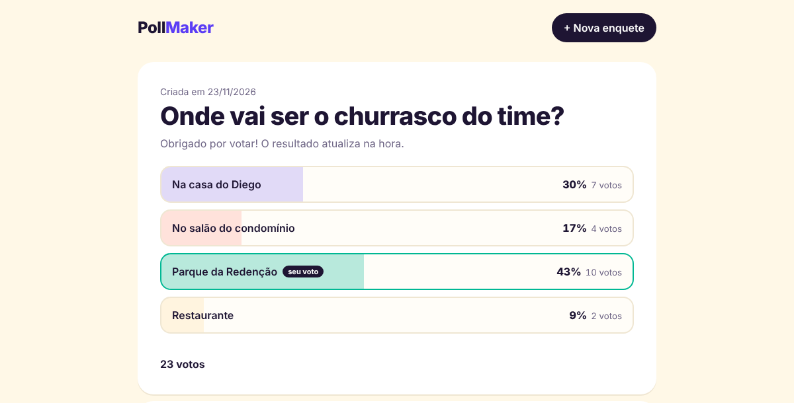

# PollMaker — Enquetes

Crie enquetes com várias opções, veja os resultados em gráfico de barras na hora e compartilhe por link.

🔗 **[Ver o site no ar](https://iamviniciuslima05.github.io/PROJETO-PollMaker/)**



## Funcionalidades

- Enquetes com **2 a 10 opções**
- **Escolha única ou múltipla**
- Opção de mostrar o resultado **só depois de votar**
- Resultado em **gráfico de barras** animado, com o líder destacado
- **Link de compartilhamento**: a enquete vai codificada no endereço
- Compartilhar no **WhatsApp** ou copiar o resultado em texto
- Atualiza **em tempo real** entre abas abertas
- Encerrar e reabrir a votação

## Tecnologias

HTML5 · CSS3 · JavaScript · localStorage

## Estrutura

```
index.html
css/style.css
js/script.js
```

## Como rodar

Não precisa instalar nada: baixe o projeto e abra o `index.html` no navegador, ou acesse a versão publicada acima.

---
Feito por **Vinicius Lima** · [Portfólio](https://viniciuslimadev.netlify.app) · [LinkedIn](https://www.linkedin.com/in/viniciuslima25/)
